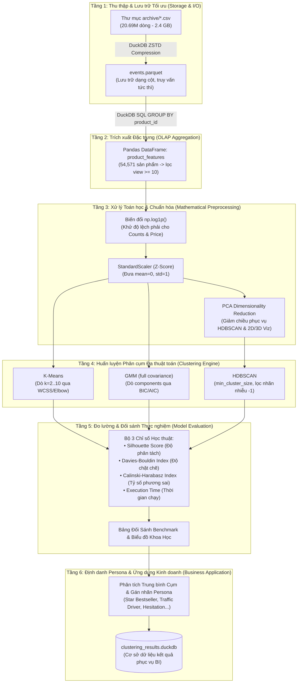

# BẢN THIẾT KẾ HỆ THỐNG & QUY TRÌNH THỰC NGHIỆM
## Đề tài: Nghiên cứu về khai phá dữ liệu và ứng dụng phân cụm sản phẩm dựa trên hành vi duyệt xem và tương tác của người dùng
**Bộ dữ liệu:** eCommerce Events History in Cosmetics Shop (~20.7 triệu bản ghi, 5 tệp CSV từ 10/2019 đến 02/2020)

---

## 1. TỔNG QUAN ĐỀ TÀI & MỤC TIÊU NGHIÊN CỨU

### 1.1. Bối cảnh
Trong thương mại điện tử (E-Commerce), dữ liệu sự kiện tương tác của khách hàng (Clickstream / Event logs) mang tính chất cực lớn về khối lượng (Big Data) và chứa đựng nhiều tín hiệu ngầm về mức độ quan tâm của người dùng. Việc phân cụm sản phẩm theo phương pháp truyền thống (chỉ dựa vào danh mục hoặc giá tiền tĩnh) không phản ánh được động thái tương tác thực tế của khách hàng.

### 1.2. Mục tiêu
1. **Xây dựng Pipeline khai phá dữ liệu hiệu năng cao:** Tận dụng kiến trúc lưu trữ dạng cột (Columnar Storage) của **DuckDB + Parquet** để xử lý tập dữ liệu hơn 20 triệu dòng ngay trên máy trạm mà không bị tràn RAM.
2. **Khai phá đặc trưng hành vi (Feature Engineering):** Trích xuất vector đặc trưng biểu diễn phễu chuyển đổi (Sales Funnel: View $\rightarrow$ Cart $\rightarrow$ Purchase $\rightarrow$ Cart Removal) của từng sản phẩm.
3. **Thực nghiệm đối sánh đa thuật toán phân cụm:** So sánh 3 trường phái phân cụm:
   - **K-Means:** Phân vùng theo tâm (Centroid-based, cụm cầu).
   - **GMM (Gaussian Mixture Model):** Phân cụm xác suất mềm (Distribution-based, cụm elip linh hoạt).
   - **HDBSCAN:** Phân cụm theo mật độ phân cấp (Density-based, tự lọc ngoại lai/nhiễu).
4. **Định danh Persona kinh doanh:** Tự động gắn nhãn chân dung sản phẩm (Bestseller, Traffic-driver, Abandoned/Hesitation, Niche Gems) và lưu trữ kết quả phục vụ tra cứu kinh doanh.

---

## 2. KIẾN TRÚC TỔNG THỂ HỆ THỐNG (SYSTEM ARCHITECTURE)



---

## 3. DANH MỤC CÔNG NGHỆ VÀ VAI TRÒ CHI TIẾT

| STT | Tầng Chức Năng | Công nghệ / Thư viện | Vai trò cụ thể trong đề tài |
| :---: | :--- | :--- | :--- |
| **1** | **Storage & OLAP** | **DuckDB (v1.5+) + Apache Parquet** | Đóng vai trò Data Warehouse in-process. Đọc song song đa luồng toàn bộ 5 file CSV (~2.4 GB), nén ZSTD thành Parquet. Chạy truy vấn SQL tổng hợp 20 triệu dòng trong < 5 giây mà không cần Spark hay DBMS cồng kềnh. |
| **2** | **Data Manipulation** | **Pandas (v3.0+) & NumPy** | Chứa ma trận đặc trưng sau khi aggregate; thực hiện biến đổi toán học $np.log1p$, xử lý giá trị khuyết (NaN/Inf) và ghép nối nhãn. |
| **3** | **Preprocessing** | **Scikit-learn (`StandardScaler`, `PCA`)** | Chuẩn hóa $Z$-score cho không gian đặc trưng; phân tích thành phần chính (PCA) để giữ lại $\ge 85\%$ phương sai, tránh "Lời nguyền số chiều" (Curse of Dimensionality). |
| **4** | **Clustering Engine** | **Scikit-learn (`KMeans`, `GaussianMixture`, `HDBSCAN`)** | Huấn luyện đồng thời 3 mô hình đại diện cho 3 họ thuật toán: Phân vùng (Partitioning), Xác suất (Probabilistic) và Mật độ (Density-based). |
| **5** | **Metrics & Benchmarking** | **Scikit-learn Metrics** | Đo lường khách quan: Silhouette Coefficient ($[-1, 1], \uparrow$), Davies-Bouldin Index ($\ge 0, \downarrow$), Calinski-Harabasz Index ($\uparrow$). Đo lường thời gian thực thi (Runtime). |
| **6** | **Visualization** | **Matplotlib & Seaborn** | Vẽ đồ thị Elbow (WCSS), đường cong BIC/AIC, biểu đồ phân tán không gian cụm PCA 2D/3D và biểu đồ Radar phân tích đặc tính Persona. |

---

## 4. CHI TIẾT VECTOR ĐẶC TRƯNG SẢN PHẨM (FEATURE ENGINEERING)

Mỗi sản phẩm ($product\_id$) được trích xuất thành 1 vector 10 chiều phản ánh hành vi tương tác và hiệu quả chuyển đổi:

| STT | Tên đặc trưng | Công thức / Truy vấn DuckDB SQL | Ý nghĩa nghiệp vụ | Tiền xử lý |
| :---: | :--- | :--- | :--- | :---: |
| **1** | `view_count` | `COUNT(CASE WHEN event_type = 'view' THEN 1 END)` | Tần suất xuất hiện và độ phủ quan tâm | $np.log1p$ |
| **2** | `cart_count` | `COUNT(CASE WHEN event_type = 'cart' THEN 1 END)` | Ý định mua sắm bước đầu | $np.log1p$ |
| **3** | `remove_count` | `COUNT(CASE WHEN event_type = 'remove_from_cart' THEN 1 END)` | Hành vi hủy chọn hoặc băn khoăn về giá | $np.log1p$ |
| **4** | `purchase_count` | `COUNT(CASE WHEN event_type = 'purchase' THEN 1 END)` | Sản lượng tiêu thụ thực tế | $np.log1p$ |
| **5** | `est_revenue` | `purchase_count * avg_price` | Doanh thu ước tính (GMV Proxy) | $np.log1p$ |
| **6** | `avg_price` | `AVG(price)` | Mặt bằng giá niêm yết của sản phẩm | $np.log1p$ |
| **7** | `view_to_cart_rate` | $cart\_count / view\_count$ | Khả năng thu hút người xem bỏ vào giỏ | MinMax/Std |
| **8** | `cart_to_purchase_rate` | $purchase\_count / cart\_count$ | Hiệu suất chốt đơn sau khi đã bỏ giỏ | MinMax/Std |
| **9** | `overall_conversion_rate` | $purchase\_count / view\_count$ | Tỷ lệ chuyển đổi phễu tổng thể ($CR$) | MinMax/Std |
| **10** | `cart_removal_rate` | $remove\_count / cart\_count$ | Tỷ lệ từ bỏ sản phẩm ngay tại giỏ hàng | MinMax/Std |

> **Điều kiện lọc chất lượng:** Chỉ giữ lại các sản phẩm có `view_count >= 10` để loại bỏ các sản phẩm mới thêm hoặc quá ít tương tác gây nhiễu tỷ lệ phái sinh.

---

## 5. THIẾT KẾ THỰC NGHIỆM ĐA THUẬT TOÁN (CLUSTERING EXPERIMENT)

### 5.1. Thuật toán 1: K-Means (Baseline chuẩn)
- **Cơ chế:** Phân hoạch không gian thành $k$ cụm dựa trên cực tiểu hóa tổng bình phương khoảng cách đến tâm cụm (Within-Cluster Sum of Squares - WCSS):
  $$\min \sum_{j=1}^{k} \sum_{x \in C_j} \|x - \mu_j\|^2$$
- **Dò tham số $k$:** Chạy vòng lặp $k \in [2, 10]$, tính WCSS (Elbow Method) và Silhouette Score để xác định "điểm khuỷu tay" tối ưu.

### 5.2. Thuật toán 2: Gaussian Mixture Model - GMM (Phân cụm mềm)
- **Cơ chế:** Giả định dữ liệu sinh ra từ hỗn hợp của $k$ phân phối chuẩn đa chiều $\mathcal{N}(\mu_j, \Sigma_j)$.
- **Cấu hình:** Sử dụng ma trận hiệp phương sai đầy đủ (`covariance_type='full'`) để phát hiện các cụm có dạng elip xoay tự do trong không gian.
- **Dò tham số $k$:** Sử dụng chỉ số thông tin Bayes (BIC - Bayesian Information Criterion):
  $$BIC = k \ln(n) - 2 \ln(\hat{L})$$
  Số cụm tối ưu tương ứng với giá trị BIC nhỏ nhất (tránh over-fitting).

### 5.3. Thuật toán 3: HDBSCAN (Phân cụm theo mật độ phân cấp)
- **Cơ chế:** Tìm kiếm các vùng có mật độ điểm cao cách biệt bởi vùng thưa thớt, không gượng ép mọi điểm phải thuộc về một cụm hình học cố định.
- **Đầu vào:** Không gian đặc trưng sau khi giảm chiều qua **PCA (5 chiều)** để tối ưu tính toán khoảng cách mật độ.
- **Xử lý nhiễu:** Các điểm dị biệt hoặc nằm ở vùng loãng sẽ được gán nhãn `-1` (Noise). Tỷ lệ nhiễu (% Noise) sẽ được thống kê riêng.

---

## 6. TIÊU CHÍ ĐÁNH GIÁ VÀ SO SÁNH (EVALUATION METRICS)

Để đảm bảo tính khách quan trong nghiên cứu học thuật, 3 chỉ số nội tại (Internal Validation Metrics) được đo lường đồng thời:

1. **Silhouette Score ($S \in [-1, 1]$):**
   - Đo mức độ tương đồng của một điểm với cụm của nó so với các cụm khác.
   - Điểm càng tiến gần $+1$ thể hiện cụm phân tách rõ ràng.
   - *Tối ưu hóa tính toán:* Áp dụng Stratified Random Subsampling ($N=10,000$) để tính toán nhanh, tránh quá tải RAM $O(N^2)$.
2. **Davies-Bouldin Index ($DBI \ge 0$):**
   - Tỷ số giữa độ tán xạ nội cụm và khoảng cách giữa các tâm cụm.
   - Giá trị càng nhỏ ($\downarrow$) thể hiện cụm càng chặt chẽ và tách biệt tốt.
3. **Calinski-Harabasz Index ($CHI > 0$):**
   - Tỷ số giữa phương sai giữa các cụm và phương sai trong nội bộ cụm.
   - Giá trị càng lớn ($\uparrow$) chứng tỏ cấu trúc cụm càng vững chắc.
4. **Execution Time (Giây):**
   - Đánh giá độ phức tạp thuật toán và khả năng mở rộng (Scalability) trong môi trường sản xuất thực tế.

---

## 7. BẢNG QUY ĐỔI CHÂN DUNG KINH DOANH (PRODUCT PERSONA MATRIX)

Sau khi phân cụm, hệ thống tổng hợp vector trung bình của từng nhóm để ánh xạ sang ngôn ngữ kinh doanh:

| Persona | Đặc điểm hành vi | Mức giá | Ý nghĩa & Chiến lược ứng dụng |
| :--- | :--- | :--- | :--- |
| **1. Ngôi sao doanh thu (Star Bestsellers)** | View cao, Cart cao, Purchase cao, CR cao, GMV lớn. | Đa dạng | Sản phẩm chủ lực gánh doanh số. Cần ưu tiên vị trí hiển thị trang chủ, đảm bảo tồn kho chuỗi cung ứng. |
| **2. Hàng mồi kéo Traffic (Traffic Drivers)** | View cực lớn, Cart trung bình, Purchase vừa, CR thấp. | Thường rẻ | Đóng vai trò thu hút khách vào gian hàng. Dùng làm sản phẩm khuyến mãi, banner quảng cáo. |
| **3. Hàng gây phân vân (High Hesitation / Drop-offs)** | Cart cao nhưng Remove_cart cũng rất cao, Drop-off lớn. | Trung bình - Cao | Khách muốn mua nhưng ngập ngừng vì giá hoặc phí ship. Cần bắn voucher giảm giá ngay khi khách thêm giỏ. |
| **4. Hàng ngách giá trị cao (High-Ticket Niche Gems)** | View ít/vừa, nhưng Cart-to-Purchase rất cao, ít bỏ giỏ. | Cao | Phân khúc khách hàng mục tiêu rõ ràng. Không cần giảm giá đại trà, tập trung chăm sóc cá nhân hóa. |
| **5. Sản phẩm ngủ đông (Sleeping / Dead Stock)** | View thấp, Cart thấp, Purchase gần như bằng 0. | Đa dạng | Hàng tồn kho kém thu hút. Cần combo xả kho hoặc giảm hiển thị để nhường tài nguyên cho sản phẩm khác. |

---

## 8. CẤU TRÚC DỰ ÁN DỰ KIẾN (PROJECT DIRECTORY TREE)

```text
code_kpdl/
│
├── archive/                                # Thư mục chứa 5 CSV dữ liệu gốc (2.4 GB)
│   ├── 2019-Oct.csv
│   ├── 2019-Nov.csv
│   ├── 2019-Dec.csv
│   ├── 2020-Jan.csv
│   └── 2020-Feb.csv
│
├── data/                                   # Dữ liệu trung gian & lưu trữ tối ưu
│   ├── events.parquet                      # Nén ZSTD toàn bộ 20.7 triệu dòng
│   └── product_features.parquet            # Bảng đặc trưng hành vi sản phẩm
│
├── outputs/                                # Kết quả thực nghiệm học thuật
│   ├── figures/                            # Biểu đồ khoa học
│   │   ├── elbow_kmeans.png                # Đồ thị WCSS tìm k tối ưu
│   │   ├── bic_gmm.png                     # Đồ thị BIC cho GMM
│   │   ├── cluster_scatter_pca.png         # Biểu đồ phân tán cụm không gian 2D/3D
│   │   └── persona_radar_chart.png         # Biểu đồ Radar so sánh đặc tính Persona
│   ├── clustering_benchmark.csv            # Bảng số liệu Silhouette, DBI, CHI, Time
│   └── persona_summary.csv                 # Bảng thống kê chi tiết từng Persona
│
├── src/                                    # Mã nguồn module hóa
│   ├── __init__.py
│   ├── step1_convert_parquet.py            # Chuyển đổi CSV sang Parquet bằng DuckDB
│   ├── step2_feature_extract.py            # DuckDB SQL trích xuất 10 đặc trưng hành vi
│   ├── step3_preprocessing.py              # Log1p, StandardScaler, PCA Pipeline
│   ├── step4_clustering.py                 # Huấn luyện K-Means, GMM, HDBSCAN
│   ├── step5_evaluation.py                 # Benchmark đối sánh & xuất biểu đồ
│   └── step6_persona_profiling.py          # Gán nhãn Persona & lưu DuckDB
│
├── main.py                                 # Pipeline điều phối chạy toàn bộ từ A -> Z
└── BAN_THIET_KE_HE_THONG.md                # Bản thiết kế chi tiết này
```

---

## 9. KẾ HOẠCH BẮT ĐẦU CODE

1. **Bước 1:** Khởi tạo cấu trúc thư mục (`data/`, `outputs/figures/`, `src/`).
2. **Bước 2:** Cài đặt `step1_convert_parquet.py` và chạy thực thi để chuyển đổi dữ liệu thô sang `events.parquet`.
3. **Bước 3:** Cài đặt `step2_feature_extract.py` với câu lệnh SQL DuckDB tối ưu để xuất ma trận đặc trưng.
4. **Bước 4:** Cài đặt `step3_preprocessing.py` và `step4_clustering.py` để huấn luyện 3 mô hình.
5. **Bước 5:** Cài đặt `step5_evaluation.py` để sinh số liệu benchmark và biểu đồ trực quan hóa.
6. **Bước 6:** Cài đặt `step6_persona_profiling.py` và `main.py` để hoàn tất toàn bộ đề tài.
